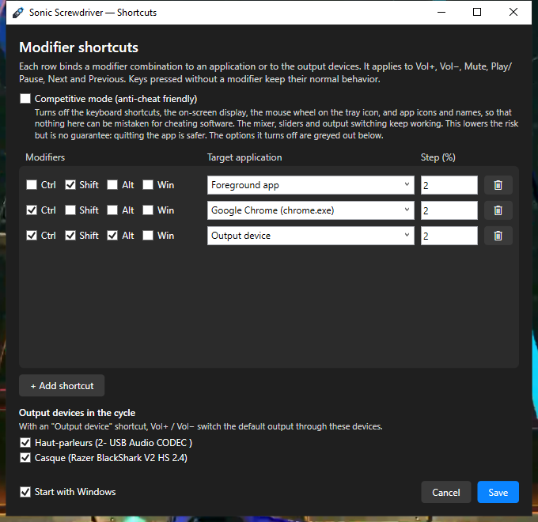

# Sonic Screwdriver

A lightweight per-app volume mixer for Windows 10/11 that lives in the notification area, with
**modifier + media key shortcuts** that act on one specific app instead of the whole system.

Press `Shift + Vol−` to turn Spotify down while the game keeps its volume. `Ctrl + Mute` silences
whatever window is in front. `Alt + Vol+` switches your headset to the speakers.

<p align="center">
  &nbsp;&nbsp;&nbsp;
  
</p>

## Features

- **Per-app mixer.** Click the tray icon to see every output device, its volume, and the apps
  playing on it. Each app gets its own slider and mute button, and the list updates live.
- **Shortcuts on your media keys.** Bind a modifier combination (Ctrl, Alt, Shift, Win, or any mix)
  to a target. The same combination then drives Vol+, Vol−, Mute, Play/Pause, Next and Previous:
  - **a specific app** (`spotify.exe`, `discord.exe`, …): volume, mute and media control for that app only;
  - **the foreground app**: whatever window has focus;
  - **output devices**: Vol+ / Vol− cycle the default output through the devices you choose.
- **Media keys stay normal.** A media key without a modifier, or with an unbound combination, keeps
  its usual Windows behavior.
- **On-screen display.** A small, non-intrusive overlay shows the app icon, its name and the new level.
- **Device control.** Set the default output from the mixer, or right-click an app to send it to
  another output.
- **Mouse wheel.** Scroll over the tray icon to change the master volume, or over a mixer row to
  change that app.
- **At a glance.** The tray tooltip and menu show the current output device and your shortcuts.
- **Competitive mode.** One switch turns off everything an anti-cheat could flag (shortcuts, overlay, process
  lookups) for online games. See [Games and anti-cheat](#games-and-anti-cheat).
- **Light.** Around 20 MB of RAM and no CPU at idle; no polling, everything is event driven.

## Settings

Right-click the tray icon, then **Shortcut settings**. Each row is a modifier combination, the app it controls
(a specific app, the foreground app or the output devices) and the volume step. The same window picks the output
devices used by the cycle shortcut, the Start with Windows option and **Competitive mode**, which greys out
everything it turns off.

<p align="center">
  &nbsp;&nbsp;
  
</p>

## Why

I wanted to change the volume of several apps quickly while a game was running full screen: turn Discord up,
the music down, without leaving the game. I had been using hotkey scripts, but they were a pain to maintain, and I
could not find an existing tool that did what I wanted. So I built one: a small, light mixer whose shortcuts live on
the media keys and act on the app you choose.

## Install

1. Install the [.NET 8 Desktop Runtime](https://dotnet.microsoft.com/download/dotnet/8.0) if you don't have it
   (the installer checks and links to it).
2. From the Releases page, download either:
   - `SonicScrewdriver-Setup-x.y.z.exe`: per-user install, no admin rights, Start menu shortcut,
     optional start with Windows, clean uninstall;
   - or `SonicScrewdriver.exe`: portable, just run it.
3. Right-click the tray icon, choose **Shortcut settings**, and add your shortcuts.

Windows SmartScreen may warn on first run because the files are not code-signed:
click **More info**, then **Run anyway**.

The default shortcut is `Ctrl + media keys` on the foreground app. Settings are stored in
`%APPDATA%\SonicScrewdriver\settings.json`.

## Limitations

- **Media control:** Play/Pause, Next and Previous only reach apps that register with Windows media
  controls (Spotify, browsers, most players).
- **Browsers:** all tabs and installed web apps of a browser share a single volume, because the browser
  plays all their audio through one process.
- **Administrator windows:** when an elevated window has focus, Windows does not pass keys to the app
  unless it runs elevated too.
- **Undocumented APIs:** changing the default device and routing an app to an output use undocumented
  Windows interfaces, the same ones EarTrumpet uses.

## Games and anti-cheat

Sonic Screwdriver is not a cheat: it installs no driver, injects nothing into other programs and never reads their
memory. Even so, anti-cheat systems are opaque, and a global keyboard hook can look suspicious to some of them, so
compatibility cannot be guaranteed.

For online games with strict anti-cheat (Vanguard, FACEIT, EasyAntiCheat, BattlEye), turn on **Competitive mode**
(tray menu, or Shortcut settings) or quit the app first. In that mode:

| Switched off | What you lose |
|---|---|
| The keyboard hook | All modifier + media key shortcuts, and output device cycling |
| The on-screen display | The overlay shown after a shortcut |
| Mouse wheel on the tray icon | Master volume with the wheel |
| Lookups of other programs | App icons and friendly names (the exe name and a generic icon are shown instead) |

The mixer, the sliders, switching the default output and the physical media keys keep working. Competitive mode
lowers the risk but does not remove it: quitting the app is the safest choice.

## Security

- The keyboard hook only looks at the six media keys; no other key is read or stored. The app does not
  use the network and collects nothing.
- Releases are built by GitHub Actions from the tagged commit, scanned with Microsoft Defender and
  [VirusTotal](https://www.virustotal.com) (the report links are added to the release notes), and come
  with `SHA256SUMS.txt`.
- You can check that a download was built from this repository (needs the [GitHub CLI](https://cli.github.com)):

  ```bash
  gh attestation verify SonicScrewdriver-Setup-x.y.z.exe --repo leroidubid/SonicScrewdriver
  ```

- **Antivirus false positives.** The files are not code-signed, and a few machine-learning engines on VirusTotal
  (for example SecureAge and Acronis) flagged an early build as suspicious, while Microsoft Defender and the
  other engines found nothing. These engines react to the API calls any keyboard-shortcut tool needs (a keyboard
  hook, key injection, start with Windows), not to anything harmful. To check a download yourself, compare its
  hash with `SHA256SUMS.txt`, verify the attestation above, or read and build the source.

## Build

Requires the .NET 8 SDK.

```bash
dotnet test
```

```bash
dotnet publish src/SonicScrewdriver -c Release -r win-x64 --self-contained false -p:PublishSingleFile=true -p:PublishReadyToRun=true -p:DebugType=none -o publish
```

Installer (requires [Inno Setup 6](https://jrsoftware.org/isinfo.php), after publishing):

```bash
iscc installer/SonicScrewdriver.iss /DAppVersion=1.0.0
```

`tools/e2e-test.ps1` runs an end-to-end test against the running app (synthetic key presses).

## License

[MIT + Commons Clause](LICENSE): free to use, modify and share, but **not to sell**.

- You can use it, at home or at work, modify it, fork it, and share it for free.
- You cannot sell it, sell a modified version, or sell a service whose value comes mainly from it
  (paid hosting, paid support, a paid product built around it) without my written permission.
- Want to use it commercially? Contact me through my [GitHub profile](https://github.com/leroidubid).
- This is a source-available license, not an OSI-approved open-source one.

Contributions are welcome: see [CONTRIBUTING.md](CONTRIBUTING.md).

The name nods to a certain time traveller's favourite tool. This project is not affiliated with or
endorsed by the BBC.
