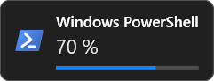
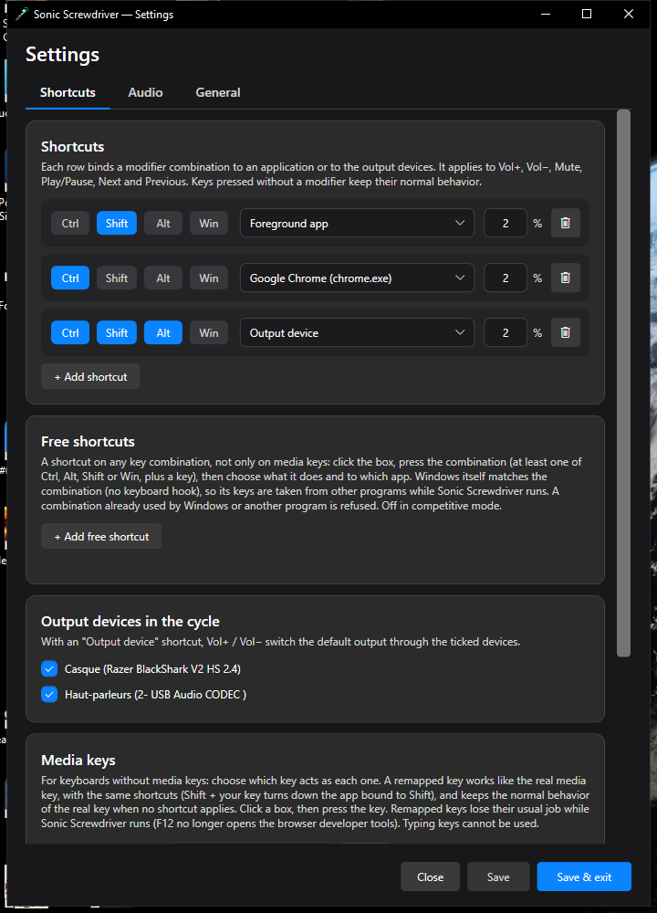
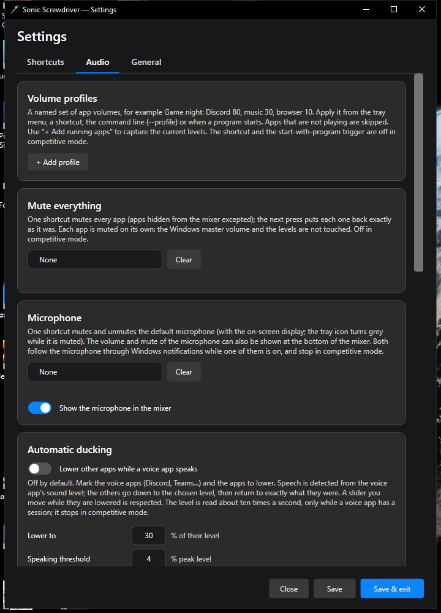
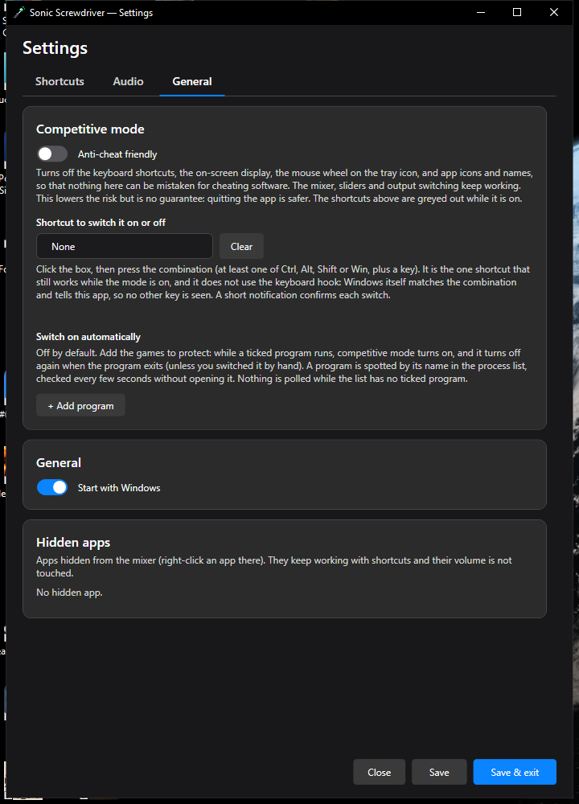

# Sonic Screwdriver

A lightweight per-app volume mixer for Windows 10/11 that lives in the notification area, with
**modifier + media key shortcuts** that act on one specific app instead of the whole system.

Press `Shift + Vol−` to turn Spotify down while the game keeps its volume. `Ctrl + Mute` silences
whatever window is in front. `Alt + Vol+` switches your headset to the speakers.

<p align="center">
  &nbsp;&nbsp;&nbsp;
  
</p>

## Features

- **Per-app mixer.** Click the tray icon to see every output device, its volume, and the apps
  playing on it. Each app gets its own slider and mute button, and the list updates live.
- **Shortcuts on your media keys.** Bind a modifier combination (Ctrl, Alt, Shift, Win, or any mix)
  to a target. The same combination then drives Vol+, Vol−, Mute, Play/Pause, Next and Previous:
  - **a specific app** (`spotify.exe`, `discord.exe`, …): volume, mute and media control for that app only;
  - **the foreground app**: whatever window has focus;
  - **output devices**: Vol+ / Vol− cycle the default output through the devices you choose.
- **Remap the media keys.** No media keys on your keyboard (compact keyboards, laptops where they sit behind `Fn`)?
  In the settings, choose which key acts as Vol+, Vol−, Mute, Play/Pause, Next and Previous (for example F10, F11,
  F12). A remapped key works exactly like the real one: `Shift + F11` turns down the app bound to Shift, a bare
  `F11` lowers the master volume. A remapped key loses its usual job while the app runs, and the remaps are off in
  competitive mode (they need the keyboard hook).
- **Free shortcuts.** Not limited to media keys: record any combination (Ctrl, Alt, Shift or Win plus any key, for
  example `Ctrl + Alt + F8`) and choose what it does (Vol+, Vol−, Mute, Play/Pause, Next, Previous), to which app (a
  specific app, the foreground app or the output devices) and the volume step. These use `RegisterHotKey`: Windows
  matches the combination itself, so there is no extra keyboard hook, and the keys of a combination are taken from
  other programs only while it is registered. A combination already used by Windows or another program is refused
  with a message in the settings. Off in competitive mode.
- **Media keys stay normal.** A media key without a modifier, or with an unbound combination, keeps
  its usual Windows behavior.
- **On-screen display.** A small, non-intrusive overlay shows the app icon, its name and the new level.
- **Device control.** Set the default output from the mixer, or right-click an app to send it to
  another output.
- **Pin or hide apps.** Right-click an app in the mixer to **pin it to the top** of its device list (pinned apps keep
  a stable order) or **hide it from the mixer**. A hidden app keeps working with your shortcuts and its volume is not
  touched; the **Hidden apps** card in the settings lists them with a **Show again** button.
- **Mouse wheel.** Scroll over the tray icon to change the master volume, or over a mixer row to
  change that app.
- **At a glance.** The tray tooltip and the right-click menu show the current output device and your shortcuts. The
  menu is drawn like the mixer (same theme, above the taskbar, closes on Escape or a click elsewhere, usable with the
  arrow keys) and holds Settings, the Competitive mode switch and Quit.
- **Competitive mode.** One switch turns off everything an anti-cheat could flag (shortcuts, overlay, process
  lookups) for online games, with an optional shortcut to flip it. See [Games and anti-cheat](#games-and-anti-cheat).
- **Volume profiles.** A named set of app volumes (and optionally the master volume), for example "Game night":
  Discord 80, music 30, browser 10. Apply it from the tray menu, a shortcut, the command line, or automatically when
  a program starts. Apps that are not playing are skipped.
- **Automatic ducking.** Off by default. Mark a voice app (Discord, Teams...) and the apps to lower: while the voice
  app speaks, the others go down to the level you choose, then come back to exactly what they were. A slider you move
  in the meantime is respected.
- **Streamer mode.** The reverse of ducking, off by default. Tick the apps to lower (a game, music...): while you speak
  into the default microphone they go down to the level you choose, then come back to exactly what they were. A
  threshold (5 % by default) ignores room noise, and delays avoid pumping on pauses. It works together with automatic
  ducking: the levels always come back to what you had.
- **Microphone.** A shortcut mutes and unmutes the default microphone (the tray icon turns grey while it is muted),
  and the mixer can show the microphone's volume and mute.
- **Mute everything.** One shortcut mutes every app, the next press restores each app's previous state exactly. The
  Windows master volume is not touched.
- **Maximum volume per app.** A cap for an app (a browser at 40 %): sliders, shortcuts, profiles and commands stop at
  it, and an app that goes above it by itself is brought back.
- **Remembered routing.** "Discord always on the headset, Spotify on the speakers": a rule is applied when the app's
  sound starts, and skipped when the device is not plugged in.
- **Output device priority.** An ordered list of devices (headset, then speakers, then monitor): when devices come
  and go, the default output becomes the first one of the list that is plugged in. An output you pick by hand is kept
  until the first plugged-in device of the list changes.
- **Now playing.** Optionally, each mixer row shows the title and artist of what the app plays, with Previous,
  Play/Pause and Next buttons (read only while the mixer is open).
- **Command line.** `SonicScrewdriver.exe --set spotify.exe 30`, `--profile "Game night"`, `--toggle-competitive`...
  for Stream Deck, Touch Portal or AutoHotkey. See [Command line](#command-line).
- **Light.** Around 20 MB of RAM and no CPU at idle; everything is event driven. The only timers: the optional
  automatic competitive mode and program-start profiles (a process-name check every 5 seconds, only if you list a
  program), automatic ducking (a sound-level check ten times a second, only while a voice app is running) and
  streamer mode (the same check on the microphone, only while it is on and an app is ticked).
  Every one of the new observers (ducking, streamer mode, microphone, routing, output priority, now playing, the maximum-volume
  watch) costs nothing when its feature is off, and stops in competitive mode.

## Settings

Right-click the tray icon, then **Settings**. The window has three tabs (Ctrl+Tab or the arrow keys switch between
them, and the window remembers the last one while the app runs), each made of one card per topic. **Save** applies
the settings and keeps the window open (a short "Saved" appears, and Cancel becomes Close); **Save & exit**
(Enter) applies them and closes the window.

**Shortcuts** tab:

- **Shortcuts**: each row is a modifier combination, the app it controls (a specific app, the foreground app or
  the output devices) and the volume step.
- **Free shortcuts**: any key combination bound to an action (Vol+, Vol−, Mute, Play/Pause, Next, Previous), a target
  and a step. Duplicate combinations and combinations that Windows or another program already owns are refused.
- **Output devices in the cycle**, and **Media keys** to choose which physical keys act as Vol+, Vol-, Mute, Play,
  Next and Previous.

**Audio** tab:

- **Volume profiles**: for each profile its apps and volumes (with "Add running apps" to capture the current levels),
  an optional master volume, an optional shortcut and an optional program that applies it when it starts.
- **Mute everything** and **Microphone**: the shortcut of each, and showing the microphone in the mixer.
- **Automatic ducking**: the voice apps and the apps to lower, the level to lower to, the speaking threshold, and the
  reaction and release delays. Off by default.
- **Streamer mode**: the switch, the apps to lower while you speak (one tick per app, "Add running apps"), the level to
  lower to (30 % of their level by default), the microphone threshold, and the reaction and release delays. Off by
  default.
- **Output device priority**: the switch and the ordered list of devices (move up, move down, remove).
- **Remembered routing**: rules "app on output device".
- **Maximum volume per app**: a cap in percent per app.
- **Now playing**: showing what is playing in the mixer.

**General** tab:

- **Competitive mode**: the switch, a shortcut to turn it on or off, and the games that turn it on
  automatically. While it is on, the options it switches off are greyed out.
- **General**: Start with Windows.
- **Hidden apps**: the apps hidden from the mixer, each with a **Show again** button.

Shortcuts, the microphone, ducking, streamer mode, routing, the device priority list, the now-playing line and the start-with-a-program
trigger of profiles are greyed out while competitive mode is on; a red "Competitive mode" label marks the cards, and the
tabs, that have greyed options.

<p align="center">
  &nbsp;
  &nbsp;
  &nbsp;
  
</p>

## Command line

A second launch of `SonicScrewdriver.exe` with a command hands it to the running instance (through a hidden window of
the running app: no new background service) and exits with a code. The app must already be running; a command never
starts it.

| Command | Does |
|---|---|
| `--set <app> <0-100>` | Sets the app's volume (the maximum volume of the app still applies) and unmutes it when above 0 |
| `--mute <app>` / `--unmute <app>` / `--toggle-mute <app>` | Mutes, unmutes or toggles the app |
| `--profile "<name>"` | Applies a volume profile |
| `--mute-all` | Mutes every app, or restores them (same as the shortcut) |
| `--mic-mute` | Mutes or unmutes the default microphone |
| `--toggle-competitive` | Switches competitive mode |

`<app>` is the exe name, with or without `.exe` (`spotify` and `spotify.exe` are the same). Examples:

```bash
SonicScrewdriver.exe --set spotify.exe 30
SonicScrewdriver.exe --mute discord
SonicScrewdriver.exe --profile "Game night"
```

Exit codes: `0` done, `1` unknown command or bad arguments, `2` Sonic Screwdriver is not running, `3` the app (or the
profile, or the microphone) was not found (an app is found only while it plays sound), `4` refused because competitive
mode is on (only `--toggle-competitive` works then, like the shortcuts), `5` no answer. A short message is printed on
the console that started the command (nothing is shown when started from a shortcut or a launcher).

- **Stream Deck:** use an action that runs a program (for example *System > Open*, or a plugin that runs a command
  line) with the full command, such as `"C:\Path\SonicScrewdriver.exe" --profile "Game night"`.
- **Touch Portal:** use its action that runs an application, with the same path and arguments.
- **AutoHotkey:** `Run '"C:\Path\SonicScrewdriver.exe" --set spotify.exe 30'`, or `RunWait` to read the exit code.

## Why

I wanted to change the volume of several apps quickly while a game was running full screen: turn Discord up,
the music down, without leaving the game. I had been using hotkey scripts, but they were a pain to maintain, and I
could not find an existing tool that did what I wanted. So I built one: a small, light mixer whose shortcuts live on
the media keys and act on the app you choose.

## Install

1. Install the [.NET 8 Desktop Runtime](https://dotnet.microsoft.com/download/dotnet/8.0) if you don't have it
   (the installer checks and links to it).
2. From the Releases page, download either:
   - `SonicScrewdriver-Setup-x.y.z.exe`: per-user install, no admin rights, Start menu shortcut,
     optional start with Windows, clean uninstall, available in English, French, German,
     Spanish, Italian and Brazilian Portuguese (it follows the Windows display language);
   - or `SonicScrewdriver.exe`: portable, just run it.
3. Right-click the tray icon, choose **Settings**, and add your shortcuts.

Windows SmartScreen may warn on first run because the files are not code-signed:
click **More info**, then **Run anyway**.

The default shortcut is `Ctrl + media keys` on the foreground app. Settings are stored in
`%APPDATA%\SonicScrewdriver\settings.json`.

## Tested on

Checked means tried by the author; unchecked means not tested yet. The installer asks for Windows 10 version 1809
or later and the app is built for 64-bit Windows.

- [x] Windows 10 22H2 (build 19045)
- [ ] Windows 11
- [ ] Windows 10, older versions (1809 to 21H2)
- [ ] Windows 11 on ARM (runs through x64 emulation)

The default device change and the per-app output use undocumented Windows interfaces, so a new Windows build can
break them: please [open an issue](https://github.com/leroidubid/SonicScrewdriver/issues) with your Windows version.

## Limitations

- **Media control:** Play/Pause, Next and Previous only reach apps that register with Windows media
  controls (Spotify, browsers, most players).
- **Browsers:** all tabs and installed web apps of a browser share a single volume, because the browser
  plays all their audio through one process, so Sonic Screwdriver cannot set one tab alone. A browser extension
  can, or you can play in two different browsers: see the
  [FAQ](https://leroidubid.github.io/SonicScrewdriver/faq.html#browser-tabs).
- **Administrator windows:** when an elevated window has focus, Windows does not pass keys to the app
  unless it runs elevated too.
- **Undocumented APIs:** changing the default device and routing an app to an output use undocumented
  Windows interfaces, the same ones EarTrumpet uses.

## Games and anti-cheat

Sonic Screwdriver is not a cheat: it installs no driver, injects nothing into other programs and never reads their
memory. Even so, anti-cheat systems are opaque, and a global keyboard hook can look suspicious to some of them, so
compatibility cannot be guaranteed.

For online games with strict anti-cheat (Vanguard, FACEIT, EasyAntiCheat, BattlEye), turn on **Competitive mode**
(tray menu, or Settings) or quit the app first. In that mode:

| Switched off | What you lose |
|---|---|
| The keyboard hook | All modifier + media key shortcuts, remapped media keys, and output device cycling |
| The on-screen display | The overlay shown after a shortcut |
| Mouse wheel on the tray icon | Master volume with the wheel |
| Lookups of other programs | App icons and friendly names (the exe name and a generic icon are shown instead) |
| Observers and extra shortcuts | Automatic ducking, streamer mode, microphone shortcut and mixer section, remembered routing, the output priority list, the now-playing line, the maximum-volume watch, program-start profiles, the mute-everything and profile shortcuts, and the command line (except `--toggle-competitive`) |

The mixer, the sliders, switching the default output and the physical media keys keep working. Competitive mode
lowers the risk but does not remove it: quitting the app is the safest choice.

**Automatic mode (off by default).** In the settings you can list the games to protect: while a ticked program runs,
competitive mode turns on by itself, and it turns off again when the program exits. A program is spotted by its exe
name in the Windows process list, read from one snapshot every 5 seconds: the process is never opened, so no handle
or access right touches the game. Nothing runs while the list has no ticked program. If you switch the mode yourself,
the automation steps aside: a mode you turned on stays on, and one you turned off stays off until the program has
exited. An automatic "on" is not saved as your preference.

**Toggle shortcut.** In the settings you can assign a key combination (for example `Ctrl+Alt+F9`) that switches
competitive mode on and off, with a short notification each time. It has to work while the keyboard hook is
uninstalled, so it does not use a hook: it is registered with the Windows `RegisterHotKey` function, where Windows
itself matches the combination and tells the app. The app never sees any other key. The trade-off: this is a
documented, ordinary API that many programs use and is much less intrusive than a hook, but it is still one
registration that stays active in competitive mode. If you want nothing at all, leave the shortcut empty (the default)
and use the tray menu, or quit the app.

**Tested games.** What the author tried so far. "Needs Competitive mode" says whether the game works only with the
mode on (the app runs, but its keyboard hook and overlay may be refused or flagged by the anti-cheat). A result says
nothing about a future anti-cheat update, and a game that is not listed is simply untested.

| Game | Anti-cheat | Tested | Needs Competitive mode |
|---|---|---|---|
| Rocket League | EasyAntiCheat | ✅ Yes | No |
| Valorant | Vanguard (kernel driver) | ⬜ Not yet | Not known yet |
| Counter-Strike 2 through FACEIT | FACEIT Anti-Cheat (kernel driver) | ⬜ Not yet | Not known yet |
| Call of Duty: Warzone | Ricochet (kernel driver) | ⬜ Not yet | Not known yet |
| Fortnite | EasyAntiCheat and BattlEye | ⬜ Not yet | Not known yet |
| Apex Legends | EasyAntiCheat | ⬜ Not yet | Not known yet |
| Rainbow Six Siege | BattlEye | ⬜ Not yet | Not known yet |
| PUBG | BattlEye | ⬜ Not yet | Not known yet |
| Destiny 2 | BattlEye | ⬜ Not yet | Not known yet |
| Rust | EasyAntiCheat | ⬜ Not yet | Not known yet |

Tried a game that is not on the list, or hit a problem? Please
[open an issue](https://github.com/leroidubid/SonicScrewdriver/issues) with the game, the anti-cheat message and
whether Competitive mode was on.

## Security

- The keyboard hook only looks at the six media keys, and the keys you choose to remap to them (none by default);
  no other key is read or stored. The app does not
  use the network and collects nothing.
- Unexpected errors are written to `%APPDATA%\SonicScrewdriver\log.txt` (time, message and stack of each error;
  about 100 KB at most, the oldest entries are dropped). The file stays on your machine and holds no key, no volume
  and no settings; delete it whenever you like, and attach it to a bug report if you wish.
- Releases are built by GitHub Actions from the tagged commit, scanned with Microsoft Defender and
  [VirusTotal](https://www.virustotal.com) (the report links are added to the release notes), and come
  with `SHA256SUMS.txt`.
- You can check that a download was built from this repository (needs the [GitHub CLI](https://cli.github.com)):

  ```bash
  gh attestation verify SonicScrewdriver-Setup-x.y.z.exe --repo leroidubid/SonicScrewdriver
  ```

- **Antivirus false positives.** The files are not code-signed, and a few machine-learning engines on VirusTotal
  (for example SecureAge and Acronis) flagged an early build as suspicious, while Microsoft Defender and the
  other engines found nothing. These engines react to the API calls any keyboard-shortcut tool needs (a keyboard
  hook, key injection, start with Windows), not to anything harmful. To check a download yourself, compare its
  hash with `SHA256SUMS.txt`, verify the attestation above, or read and build the source.

## Build

Requires the .NET 8 SDK.

```bash
dotnet test
```

```bash
dotnet publish src/SonicScrewdriver -c Release -r win-x64 --self-contained false -p:PublishSingleFile=true -p:PublishReadyToRun=true -p:DebugType=none -o publish
```

Installer (requires [Inno Setup 6](https://jrsoftware.org/isinfo.php), after publishing):

```bash
iscc installer/SonicScrewdriver.iss /DAppVersion=1.0.0
```

`tools/e2e-test.ps1` runs an end-to-end test against the running app (synthetic key presses).

## License

[MIT + Commons Clause](LICENSE): free to use, modify and share, but **not to sell**.

- You can use it, at home or at work, modify it, fork it, and share it for free.
- You cannot sell it, sell a modified version, or sell a service whose value comes mainly from it
  (paid hosting, paid support, a paid product built around it) without my written permission.
- Want to use it commercially? Contact me through my [GitHub profile](https://github.com/leroidubid).
- This is a source-available license, not an OSI-approved open-source one.

Contributions are welcome: see [CONTRIBUTING.md](CONTRIBUTING.md).

The name nods to a certain time traveller's favourite tool. This project is not affiliated with or
endorsed by the BBC.

